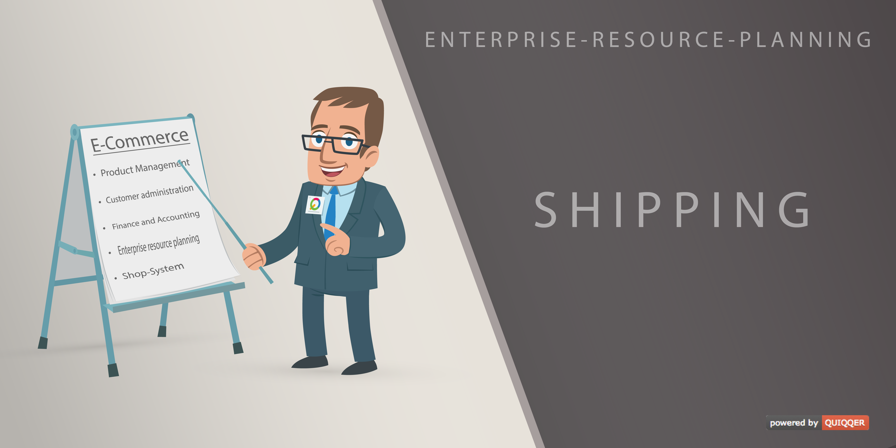

Shipping Method API for QUIQQER
======

QUIQQQER Shipping extends QUIQQER and the QUIQQER ERP system with a shipping API.
Create different shipping types for your products. 

Package name:

    quiqqer/shipping

Features
--------

- Shipping API
- Shipping Method Management
    - Allow certain Shipping methods only for certain groups of people
    - Define different shipping costs for time periods
    - Set different shipping costs for specific products
- Different rules can be assigned to each shipping method
- Each rule has a variety of adjustment options
    - Priority
    - Discount
    - Unit rule
    - Usage from / to
    - Shopping amouunt of / to
    - Purchase value of / to
    - User specification
    - Product specification

Installation
------------

The package name is: quiqqer/shipping

MCP API
-------

With `quiqqer/ai-mcp` installed, package setup registers the shipping MCP provider.
Grant `quiqqer.shipping.mcp` to the request user; it is disabled by default.
Writes additionally require `quiqqer.shipping.create`, `.edit`, or `.delete`.

- `shipping_types`: registered types for creating shipping methods.
- `shipping_list`, `shipping_get`, `shipping_create`, `shipping_update`, `shipping_delete`.
- `shipping_rule_list`, `shipping_rule_get`, `shipping_rule_create`, `shipping_rule_update`, `shipping_rule_delete`.
- `shipping_status_list`, `shipping_tracking_carriers`: read configured statuses and carriers.

Get, update and delete tools take a positive integer `id`. List tools accept `limit`
(1–100), `offset`, optional boolean `active`, and `order` (`id ASC`, `id DESC`,
`priority ASC`, or `priority DESC`). Creation is inactive by default; a method also
requires `shippingType` from `shipping_types`. Create and update accept a `data`
object. For example, `shipping_update` accepts:

```json
{"id": 12, "data": {"title": {"en": "Standard shipping"}, "active": true, "shipping_rules": [3]}}
```

Translations use installed language codes. Unknown fields, invalid types, IDs,
dates, ranges and unregistered shipping types are rejected. Updates preserve
omitted fields; supplied restriction arrays replace existing values. Detach a
rule from all shipping methods before deleting it. Returned data describes
configuration; shipping costs and eligibility still depend on the ERP order.
These tools do not change orders or send customer notifications.

Contribution
----------

- Issue Tracker: https://dev.quiqqer.com/quiqqer/shipping/issues
- Source Code: https://dev.quiqqer.com/quiqqer/shipping

Support
-------

If you have found an error or want improvements, please send an e-mail to support@pcsg.de.

Licence
-------

- GPL-3.0+
- PCSG QEL-1.0
